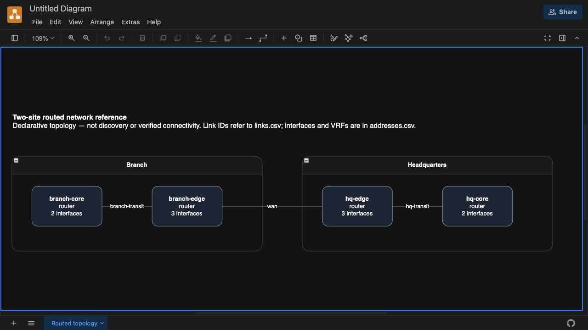

# Network Design Compiler

[](https://github.com/carlosalpo/network-design-compiler/actions/workflows/ci.yml)

**One network model. A consistent IP plan, link schedule, inventory and editable topology.**

A small Python tool for turning a declared routed-network design into reviewable engineering documents. It catches inconsistent assignments before generating deliverables: duplicate addresses, overlapping prefixes, missing endpoints, reused ports and incorrectly connected segments.

Created by **Carlos Alvarado** as a public infrastructure engineering portfolio project. All included examples are synthetic and use documentation address ranges.

## Why it exists

A diagram, an IP spreadsheet and a cabling table often drift apart when maintained separately. This compiler derives all three from the same validated JSON model. A reviewer can follow a link ID from the diagram to its ports and addresses, and can rebuild the complete package after a model change.

The result is a consistency check of declared intent. It does not discover devices, generate vendor configurations, simulate routing, deploy changes or prove live connectivity.

## Execution evidence



[View five real execution captures, raw outputs and reproducible evidence](docs/screenshots/README.md). The topology is a native draw.io render; the table/log captures use labeled static evidence viewers.

## Quick start

Requires Python 3.11 or newer. No runtime dependencies or network access are needed after installation.

```sh
git clone https://github.com/carlosalpo/network-design-compiler.git
cd network-design-compiler
python3 -m venv .venv
. .venv/bin/activate
python -m pip install .
ndc validate --input examples/two-site.json
ndc build --input examples/two-site.json --output design-output
```

Open `design-output/design.md` for the engineering report, the CSV files for tables, and `design-output/topology.drawio` in [draw.io](https://app.diagrams.net/). Use a new output directory for each build; existing files are never overwritten. Opening a design in an online editor shares it with that service/browser; use a local draw.io installation for sensitive designs.

[Download the generated example package](https://github.com/carlosalpo/network-design-compiler/releases/download/v0.1.0/network-design-compiler-example-v0.1.0.zip) to inspect the documents without installing Python.

The reference model has **2 sites, 1 VRF, 4 devices, 7 segments, 10 interfaces and 3 physical link declarations**. Speed values are declared metadata, not measurements.

## Deliverables

| File | Purpose |
| --- | --- |
| `model.json` | Canonical model with stable ordering |
| `devices.csv` | Device inventory, site, role and interface count |
| `addresses.csv` | One row per interface, including VRF, subnet, link and peer |
| `links.csv` | Port-to-port schedule, addresses and declared speed |
| `topology.drawio` | Native editable diagram with site containers and link IDs |
| `design.md` | Reviewable inventory, IP plan, link schedule and limitations |
| `validation.json` | Machine-readable findings and result |
| `manifest.json` | Input/canonical-model hashes, counts and artifact hashes |

A semantically invalid model produces **only the validation report, a failure report and the manifest**. No apparently valid topology or addressing tables are emitted. Malformed or unsupported input produces no output directory.

## Supported design scope

- IPv4 routed point-to-point links on `/30` or `/31`, and `/32` loopbacks.
- Explicit sites, VRFs, devices, interfaces and undirected physical links.
- Address and subnet uniqueness within each VRF, including across sites. Separate VRFs may reuse addresses.
- Exactly two interface assignments and one matching link per point-to-point segment; exactly one assignment and no physical link per loopback.
- Disconnected components and isolated devices are warnings about the declared graph.

The tool does not model multi-access LANs, VLAN trunks, L2 switching, IPv6, routing protocols, firewall policies, MTU, redundancy or hardware compatibility. A `switch` role labels a device with routed interfaces; it does not enable a switching model. `/31` endpoint treatment follows [RFC 3021](https://www.rfc-editor.org/rfc/rfc3021.html); device support still requires independent review.

## Try a rejected design

```sh
ndc build --input examples/invalid-duplicate-ip.json --output rejected-design
# INVALID MODEL; exit status 1. Inspect rejected-design/validation.json.
```

| Example | Expected result |
| --- | --- |
| `two-site.json` | Valid reference design |
| `p2p-31.json` | Valid design using both addresses of a `/31` |
| `disconnected.json` | Valid model with a disconnected-graph warning |
| `invalid-duplicate-ip.json` | Duplicate address rejected |
| `invalid-overlap.json` | Overlapping prefixes rejected |
| `invalid-endpoint.json` | Missing interface reference rejected |
| `invalid-port-reuse.json` | Reused link endpoint rejected |

## Documentation and verification

- [Verification record](docs/verification.md) — 107 tests and seven scenarios
- [Input contract and modeling decisions](docs/input-model.md)
- [Validation, determinism and output behavior](docs/engineering.md)
- [Security and privacy boundaries](SECURITY.md)
- [Concept illustrations](docs/illustrations/README.md) — conceptual artwork, not execution evidence

```sh
python -m pip install '.[dev]'
ruff check src tests scripts
ruff format --check src tests scripts
pytest -q
python scripts/check_examples.py --output reports/example-matrix
```

The tests cover valid/invalid models, input bounds, VRF reuse, `/31` semantics, deterministic ordering, CSV/XML/Markdown escaping, cross-artifact consistency, output protection, interrupted writes and offline execution. The seven CLI scenarios verify exit status, expected findings, native diagram structure and every emitted artifact hash. CI runs the same checks on Python 3.11, 3.12 and 3.13.

## Portfolio context

This project demonstrates network design modeling, IP addressing discipline, consistency validation, deterministic document generation and engineering review boundaries. It complements lab provisioning and change validation tools by focusing on the design deliverables that precede implementation.

MIT licensed. Contributions should use synthetic examples and include a reproducible failing model or test.
