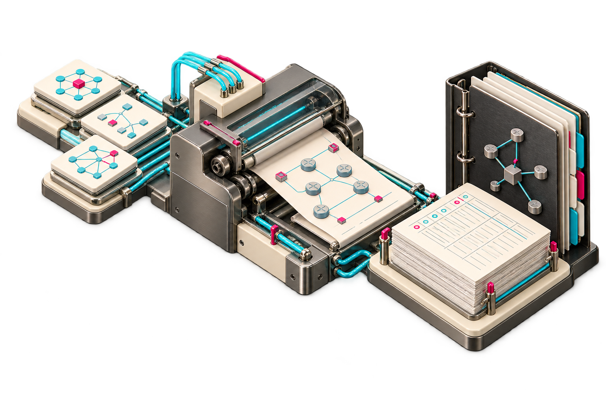

# Concept illustrations

These illustrations communicate the project idea for the personal portfolio. They are conceptual artwork, not screenshots, test results or a claim about an implemented graphical interface. The actual tool is a command-line compiler that emits documents and native draw.io XML.

