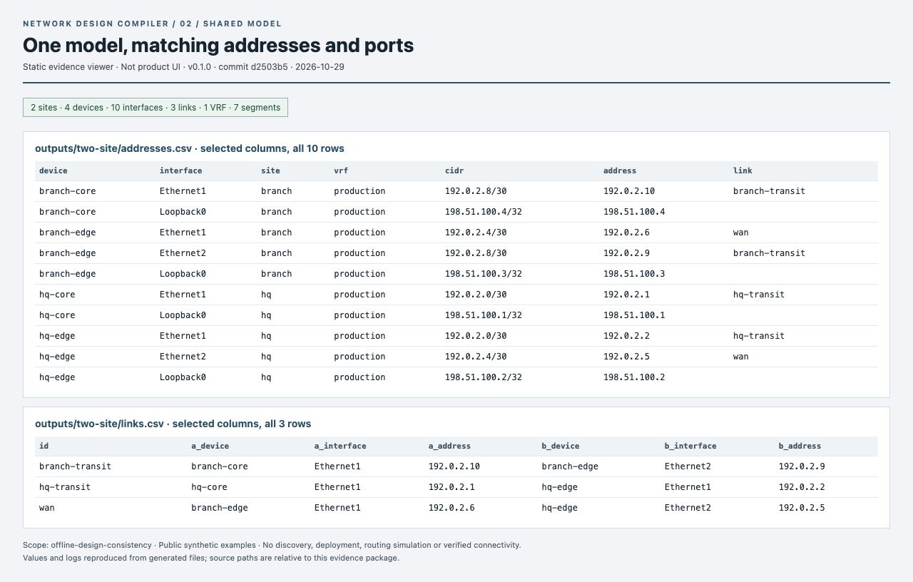
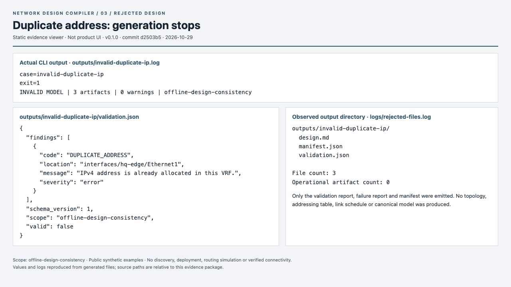
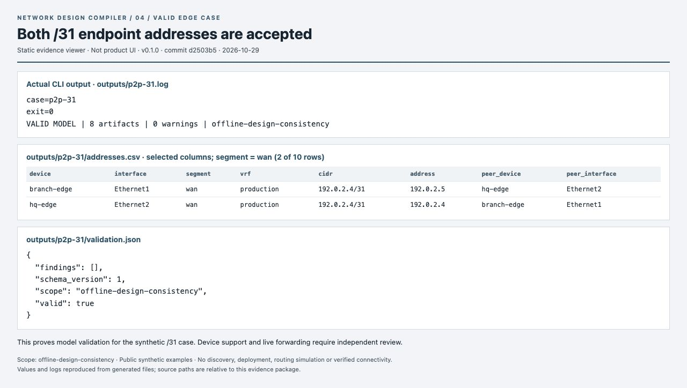
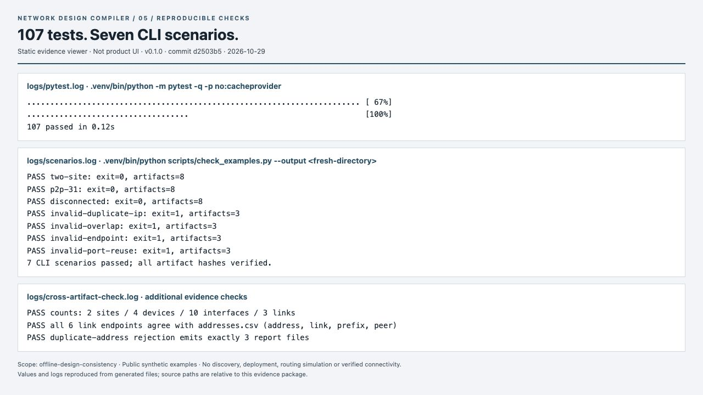

# Network Design Compiler — execution evidence

Version **0.1.0**, commit **d2503b5fa350d33782a78a429e551e2ba66612f4**. Captured on **2026-10-29**, America/Tegucigalpa (UTC−06:00), using Python 3.12.14.

This package contains five original browser screenshots, the generated artifacts behind them, seven public synthetic inputs, unedited execution logs, and static HTML evidence viewers. The viewers are explicitly labeled **Not product UI**. No screenshot text was edited, composited, redrawn or retouched. The JPEG format is the browser API's native output. The IP/ports and /31 pages use full-page captures; the other captures use the viewport as recorded in `manifest.json`.

## Captures

| Image | Evidence | Suggested use |
| --- | --- | --- |
| `images/01-native-topology.jpg` | Native generated `topology.drawio`, opened directly in draw.io through its compressed XML URL; editor UI visible | Portfolio selection 1 |
| `images/02-ip-and-ports.jpg` | All 10 IP rows and all 3 link rows; explicitly selected CSV columns | GitHub engineering documentation |
| `images/03-duplicate-rejected.jpg` | Real `DUPLICATE_ADDRESS`, CLI exit 1, and observed output directory with only three reports | Portfolio selection 2 |
| `images/04-valid-31.jpg` | Both addresses of the WAN `/31`, filtered to the two relevant rows; valid result | GitHub edge-case evidence |
| `images/05-verification.jpg` | 107 tests, seven CLI scenarios, and additional cross-artifact checks | GitHub verification evidence |

## Visual gallery

### Native editable topology


Generated XML rendered in draw.io. Design intent; no live connectivity claim.

### Shared IP plan and port schedule



Selected columns of the real generated CSV files, with all rows shown. Static evidence viewer, not product UI.

### Duplicate-address rejection



A failed model produces diagnostic reports and no topology or address tables. Static evidence viewer, not product UI.

### Valid point-to-point /31



Two relevant interface rows from the /31 example. Model validation does not establish hardware support.

### Reproducible verification



Real local logs reproduced in an evidence viewer. [The separate CI record](../verification.md) covers three Python versions.

## Native diagram review

The complete diagram was visually reviewed in draw.io at 109% using Fit Window, with the shapes sidebar hidden. All four devices, both site containers, the three link IDs and the scope text are visible. Transit labels are separated from the cards. This is an actual draw.io render, not a manually recreated SVG. Only the editor view was adjusted; the XML was not relaid out or rerouted.

The skill's repair pass produced identical before/after SHA-256 values; see `logs/drawio-repair.json`. The title “Untitled Diagram” is draw.io's browser title for a URL-loaded document; the source is `outputs/two-site/topology.drawio`. More densely populated models still need independent visual review; this capture verifies the synthetic reference model only.

## Results and boundaries

- 107 tests passed; exit 0. Timing in the raw log belongs to this run only.
- Seven CLI scenarios passed, including all emitted artifact hashes and native diagram structure.
- The reference counts are 2 sites, 4 devices, 10 interfaces, 3 links, 7 segments and 1 VRF.
- All six link endpoints agree with the IP table on address, prefix, link and peer.
- The duplicate-address example returned exit 1 and emitted exactly `design.md`, `manifest.json` and `validation.json`. “Operational artifact count: 0” means no topology, IP table, link schedule, inventory or canonical model; it does not mean zero files.
- All model inputs are byte-for-byte copies of the repository's public `examples/*.json`.
- This is **offline consistency of a declared model**. It does not verify live connectivity, discover devices, deploy configuration, simulate routing, or prove hardware compatibility. Declared speeds are not measurements.
- The compiler and tests did not access real networks. The browser accessed draw.io only to render the synthetic diagram and loopback HTTP only to capture local evidence pages.
- This package does not attest to a remote CI run. It records a separate local execution.

## Reproduce from the repository root

The original run used the existing `.venv/bin/python` and the installed `.venv/bin/ndc`. The seven-scenario runner resolves `ndc` through the environment path. All temporary and output directories were directed into the evidence workspace, with bytecode and pytest cache writes disabled.

```sh
EVIDENCE_DIR="$(mktemp -d)"
mkdir -p "$EVIDENCE_DIR/tmp"
export PYTHONDONTWRITEBYTECODE=1
export PATH="$PWD/.venv/bin:$PATH"
export TMPDIR="$EVIDENCE_DIR/tmp"
.venv/bin/python -m pytest -q -p no:cacheprovider --basetemp "$EVIDENCE_DIR/pytest-tmp"
.venv/bin/python scripts/check_examples.py --output "$EVIDENCE_DIR/reproduction-output"
```

Use a fresh `reproduction-output` directory: the compiler refuses to overwrite existing output. The original results are preserved in this package under `outputs/`. The report runner calls `.venv/bin/ndc build --input examples/<case>.json --output <destination>/<case>` for all seven cases. Successful examples return 0; semantically invalid examples return 1.

To reproduce the selected cases directly with fresh output paths:

```sh
.venv/bin/ndc build --input examples/two-site.json --output "$EVIDENCE_DIR/rebuild-two-site"
.venv/bin/ndc build --input examples/invalid-duplicate-ip.json --output "$EVIDENCE_DIR/rebuild-duplicate"
.venv/bin/ndc build --input examples/p2p-31.json --output "$EVIDENCE_DIR/rebuild-31"
```

`provenance/build_viewer.py` rebuilds the four viewers from the preserved raw outputs and performs the additional cross-artifact assertions. `provenance/repair-check.js` runs the XML repair check and refuses any change in hash. Both are evidence tooling, not part of the product.

```sh
# From this package directory:
python3 provenance/build_viewer.py
node provenance/repair-check.js outputs/two-site/topology.drawio
shasum -a 256 -c SHA256SUMS
```

The first two commands are optional regeneration checks; verify hashes before any regeneration. Screenshot appearance can vary with browser/editor versions, fonts and OS. No screenshot hashes are expected to be reproducible across separate capture sessions.

## Integrity and integration

`manifest.json` maps each capture to its relative sources and hashes all package files except itself and `SHA256SUMS`. `SHA256SUMS` covers every other file, including the manifest; it excludes only itself to avoid circular hashing. Compiler-generated manifests remain untouched inside each scenario directory.

The source, tests, scripts, examples and project metadata match the recorded implementation commit. Documentation-only integration adds this gallery and portable reproduction instructions; screenshots, raw outputs and logs retain their captured bytes. See `logs/source-state.log`.
